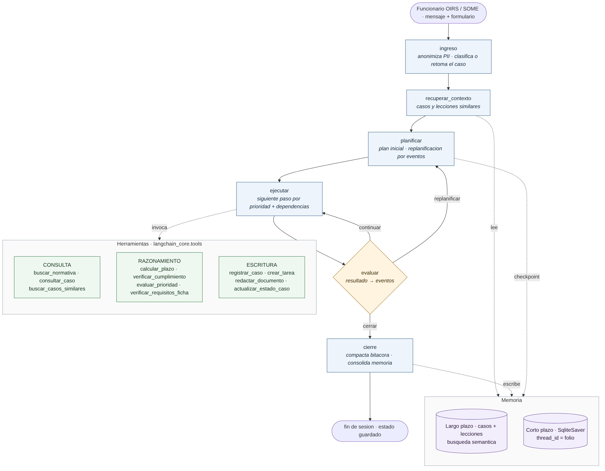
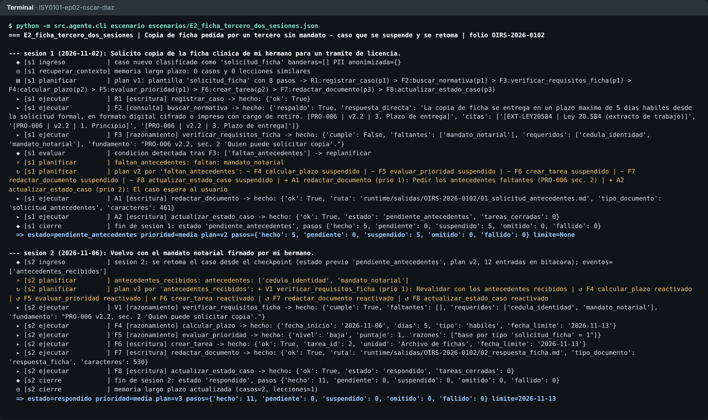

# Agente de Gestión de Casos CESFAM — LangGraph + RAG + Memoria

Agente funcional que **gestiona casos de la OIRS y del SOME** de un Centro de Salud Familiar:
recibe un reclamo, una solicitud de copia de ficha, una consulta o una alerta de inasistencias;
**planifica** los pasos, **consulta** protocolos y normativa (RAG de la EP1), **razona** sobre
plazos hábiles, requisitos y prioridad, **escribe** en el sistema OIRS (casos, tareas de
derivación y documentos) y **se adapta** cuando cambian las condiciones: un plazo GES vencido,
un antecedente faltante, una llamada sin contacto, un feriado nuevo o una herramienta caída.
Un mismo caso puede durar varios días y varias sesiones sin perder continuidad.

> **Evaluación Parcial N°2 — ISY0101 Ingeniería de Soluciones con IA (Duoc UC).**
> Continúa el proyecto de la EP1: [ISY0101-ep01-oscar-diaz](https://github.com/osdiazu/ISY0101-ep01-oscar-diaz).
> Integrantes: **Oscar Díaz Ulloa** · **[Integrante 2]**

---

## 1. Qué resuelve y cómo se evalúa

| Indicador | Dónde está en el repositorio | Evidencia |
|---|---|---|
| **IE1** Herramientas con autonomía | `src/agente/herramientas.py` — 11 *tools* en 3 familias | `tests/test_agente_ep2.py` (bloque HERRAMIENTAS) |
| **IE2** Frameworks adecuados | LangGraph (`StateGraph`, *reducers*, `SqliteSaver`) + `langchain_core.tools` | `requirements.txt`, `.github/workflows/pruebas.yml` |
| **IE3** Memoria de contenido | Corto plazo: checkpoint por folio + compactación · Largo plazo: casos y lecciones | `test_checkpoint_permite_retomar_en_otro_proceso`, E2, E5 |
| **IE4** Recuperación semántica | RAG híbrido BM25 + denso + RRF (EP1) y búsqueda vectorial en memoria | `test_memoria_largo_plazo_...`, E6 |
| **IE5** Planificación priorizada | `src/agente/planificador.py`: prioridad + dependencias + replanificación por eventos | `evidencias/demo_escenarios.txt` |
| **IE6** Documentación técnica | Este README, `docs/decisiones_tecnicas_ep2.md`, diagramas en `docs/` | — |

Resultados actuales: **49/49 pruebas** (21 heredadas de la EP1 + 28 nuevas del agente) y
**7 escenarios** de demostración que terminan en el estado esperado.

---

## 2. Instalación

Requisitos: **Python 3.10 o superior**. No requiere GPU ni clave de API.

**Windows (PowerShell)**
```powershell
git clone https://github.com/osdiazu/ISY0101-ep02-oscar-diaz
cd ISY0101-ep02-oscar-diaz
python -m venv .venv
.venv\Scripts\Activate.ps1
pip install -r requirements.txt
```

**Linux / macOS**
```bash
git clone https://github.com/osdiazu/ISY0101-ep02-oscar-diaz
cd ISY0101-ep02-oscar-diaz
python3 -m venv .venv && source .venv/bin/activate
pip install -r requirements.txt
```

Opcional, para generar con el LLM real en lugar del motor extractivo determinista:
`pip install anthropic` y definir la variable `ANTHROPIC_API_KEY`. El flujo del agente, las
herramientas y la memoria funcionan igual en ambos modos (ver decisión D1).

---

## 3. Cómo ejecutarlo

```bash
# Pruebas automatizadas (RAG + agente)
python -m pytest tests/ -v

# Los 7 escenarios de la demo, con bitácora completa; deja evidencias en evidencias/escenarios/
python -m src.agente.cli reiniciar
python -m src.agente.cli todos

# Un escenario puntual (p. ej. el caso que dura dos sesiones)
python -m src.agente.cli escenario escenarios/E2_ficha_tercero_dos_sesiones.json

# Caso libre; repetir el comando con el MISMO folio agrega una sesión al caso existente
python -m src.agente.cli caso --folio OIRS-2026-0900 --fecha 2026-11-02 \
    --texto "Solicito copia de la ficha clinica de mi madre" \
    --datos "{\"tipo\": \"solicitud_ficha\", \"solicitante\": \"tercero\", \"antecedentes\": [\"cedula_identidad\"]}"
python -m src.agente.cli caso --folio OIRS-2026-0900 --fecha 2026-11-05 \
    --texto "Traigo el mandato notarial" \
    --datos "{\"antecedentes\": [\"cedula_identidad\", \"mandato_notarial\"]}"

# Inspeccionar la memoria
python -m src.agente.cli estado  --folio OIRS-2026-0102          # corto plazo (checkpoint)
python -m src.agente.cli memoria --buscar "sospecha de cancer sin formulario"   # largo plazo

# Grafo en Mermaid generado por LangGraph
python -m src.agente.cli grafo

# Métricas del RAG heredado de la EP1
python -m src.evaluate
```

Los datos de ejecución se guardan en `runtime/` (ignorado por git): `registro_oirs.sqlite`,
`checkpoints.sqlite`, `memoria_largo_plazo.sqlite` y los documentos en `runtime/salidas/<folio>/`.
`reiniciar` borra esa carpeta para partir de cero.

---

## 4. Arquitectura y orquestación



El agente es un **grafo de estados de LangGraph** con seis nodos y una arista condicional.
El estado (`EstadoCaso`) es la memoria de trabajo del caso y se persiste en cada paso.

| Nodo | Responsabilidad |
|---|---|
| `ingreso` | Anonimiza RUT, nombre, teléfono, correo y ficha (guardrail EP1). Si el folio es nuevo, clasifica el caso; si ya existe en el *checkpoint*, interpreta el mensaje como **evento** (antecedentes recibidos, resultado de llamada, feriado nuevo). |
| `recuperar_contexto` | Busca en la memoria de largo plazo casos y lecciones semánticamente similares. |
| `planificar` | Arma el plan inicial (plantilla por tipo + ajustes por memoria) o lo **replanifica** ante cada evento. |
| `ejecutar` | Elige el siguiente paso listo (menor prioridad numérica con dependencias resueltas), resuelve sus argumentos contra el estado e invoca la herramienta. Una excepción no rompe el grafo: se convierte en evento. |
| `evaluar` | Aplica reglas sobre el resultado y decide la arista: `continuar`, `replanificar` o `cerrar`. |
| `cierre` | Resume la sesión, compacta la bitácora si es larga y consolida la memoria de largo plazo. |

Vista de componentes: [`docs/arquitectura.png`](docs/arquitectura.png). Secuencia de un caso
en dos sesiones: [`docs/secuencia_e2.png`](docs/secuencia_e2.png). Fuentes Mermaid editables
en `docs/diagramas/`.

---

## 5. Herramientas (IE1)

Definidas con `@tool` de `langchain_core`: tipadas, con descripción y salida JSON serializable.

| Familia | Herramienta | Qué hace |
|---|---|---|
| Consulta | `buscar_normativa` | RAG híbrido de la EP1 sobre 8 protocolos internos y 4 normas; devuelve respuesta citada y si hubo respaldo |
| Consulta | `consultar_caso` | Lee estado, tareas y documentos de un folio en el sistema OIRS |
| Consulta | `buscar_casos_similares` | Búsqueda semántica en la memoria de largo plazo |
| Razonamiento | `calcular_plazo` | Suma días hábiles (sin fines de semana ni feriados de `data/operacional/feriados_cl.json`) o corridos |
| Razonamiento | `verificar_cumplimiento` | Determina si un plazo está cumplido, en curso, vencido o sin datos |
| Razonamiento | `evaluar_prioridad` | Puntaje explicable por tipo, banderas de riesgo, holgura y criterios de PRO-007 |
| Razonamiento | `verificar_requisitos_ficha` | Valida quién pide la copia de ficha y qué antecedentes faltan (PRO-006) |
| Escritura | `registrar_caso` | Crea o actualiza el caso en `registro_oirs.sqlite` |
| Escritura | `crear_tarea` | Deriva una tarea a una unidad con fecha límite y prioridad |
| Escritura | `redactar_documento` | Genera y archiva respuesta OIRS (estructura MAN-003), solicitud de antecedentes, acuse o minuta |
| Escritura | `actualizar_estado_caso` | Cambia el estado y cierra tareas |

---

## 6. Memoria y recuperación de contexto (IE3, IE4)

**Corto plazo — continuidad del caso.** `SqliteSaver` de LangGraph guarda el estado completo
del grafo indexado por `thread_id = folio`. Si el caso queda *pendiente de antecedentes* o *en
seguimiento*, la siguiente sesión (otro día y otro proceso) lo retoma exactamente donde quedó:
plan, pasos suspendidos, hechos calculados y bitácora. La bitácora usa un *reducer* propio que
agrega entradas y, sobre 40, la compacta en un resumen conservando los hitos (replanificaciones
y eventos) y las 10 entradas más recientes: así se controla la ventana de contexto en flujos largos.

**Largo plazo — aprendizaje entre casos.** Al cerrar un caso se guardan en un almacén vectorial
SQLite (`casos` y `lecciones`) su resumen **anonimizado** y las lecciones de eventos relevantes
(incumplimiento GES, escalamiento, falta de respaldo). Al abrir un caso nuevo se recuperan los
más similares por coseno. En el escenario E6 un reclamo que **no menciona GES** recupera la
lección del E1 y el planificador agrega una verificación preventiva del FCIP (`origen = memoria`).

**Recuperación semántica de conocimiento.** `buscar_normativa` usa el RAG de la EP1: BM25 propio +
recuperador denso fusionados con *Reciprocal Rank Fusion*, gate de confianza y citas verificadas.

Embeddings: `sentence-transformers` multilingüe si está instalado; si no, n-gramas de caracteres
con `HashingVectorizer` (sin entrenamiento, vectores estables entre sesiones).

---

## 7. Planificación y toma de decisiones (IE5)

Cada paso del plan declara `accion`, `args`, `prioridad` (0 crítica … 3 baja), `depende_de`,
`guardar`, `proposito` y `origen`. El siguiente paso es el **pendiente de menor prioridad cuyas
dependencias están resueltas**; por eso una escalación crítica agregada a mitad del flujo se
ejecuta antes que la redacción de la respuesta.

| Evento (condición cambiante) | Cómo se detecta | Cómo cambia el plan |
|---|---|---|
| `incumplimiento_ges` | `verificar_cumplimiento` del FCIP da vencido | + tarea crítica a Subdirección Clínica, respuesta sube a prioridad 1, caso → crítico |
| `escalamiento_inmediato` | el RAG cita MAN-003 §5 en un reclamo por trato/negligencia | + tarea y minuta a Dirección **el mismo día** (prioridad 0) |
| `faltan_antecedentes` | `verificar_requisitos_ficha` no cumple | suspende la rama de entrega, pide antecedentes, caso → pendiente |
| `antecedentes_recibidos` | nueva sesión con antecedentes | reverifica y **reactiva** la rama suspendida; el plazo corre desde hoy |
| `resultado_llamada` | nueva sesión con resultado del rescate | sin contacto → visita domiciliaria a 15 días hábiles y nueva prioridad |
| `feriado_agregado` | nueva sesión decreta feriado | recalcula los plazos ya calculados |
| `sin_respaldo` | el RAG se abstiene | omite la respuesta, deriva a la unidad y emite acuse |
| `reintento` / `herramienta_no_disponible` | una herramienta lanza excepción | reintenta hasta 2 veces; luego omite lo dependiente y escala a Jefatura OIRS |
| `prioridad_critica` | `evaluar_prioridad` da crítica | adelanta los pasos pendientes |

Además, el tope de 30 iteraciones por sesión y el `recursion_limit` del grafo impiden bucles.

---

## 8. Escenarios de demostración

| ID | Caso | Qué demuestra | Resultado |
|---|---|---|---|
| E1 | Reclamo por FCIP no entregado | Detección de incumplimiento GES y replanificación | respondido · crítica |
| E2 | Copia de ficha pedida por un tercero, **2 sesiones** | Suspensión y reanudación desde el checkpoint | pendiente → respondido (límite 13-11-2026) |
| E3 | Reclamo por trato vejatorio | Decisión basada en conocimiento recuperado | escalado el mismo día · crítica |
| E4 | Consulta sin respaldo documental | Abstención y derivación | derivado |
| E5 | Rescate de paciente crónico, **3 sesiones** | Condiciones cambiantes: sin contacto y feriado nuevo | en seguimiento, plazo 30-11 → 01-12 |
| E6 | Reclamo similar al E1 | La memoria de largo plazo cambia el plan | verificación preventiva agregada |
| E7 | Falla transitoria del sistema OIRS | Reintento automático | respondido |

Salida completa en `evidencias/demo_escenarios.txt`; trazas JSON en `evidencias/escenarios/`;
documentos generados en `evidencias/documentos_generados/`. Índice de evidencias en
[`evidencias/README.md`](evidencias/README.md).



---

## 9. Estructura

```
├── src/
│   ├── agente/                 # EP2
│   │   ├── grafo.py            # StateGraph, nodos, arista condicional, fachada AgenteCasos
│   │   ├── planificador.py     # clasificación, plantillas, selección, eventos, replanificación
│   │   ├── herramientas.py     # 11 tools (consulta / razonamiento / escritura) + plantillas
│   │   ├── memoria.py          # checkpointer, reducer y compactación, memoria semántica
│   │   ├── calendario.py       # días hábiles y feriados
│   │   ├── registro.py         # sistema OIRS simulado (SQLite) + inyector de fallas
│   │   ├── config_agente.py
│   │   └── cli.py
│   ├── agent.py, index.py, ingest.py, guardrails.py, prompts.py, llm.py   # RAG EP1
│   └── evaluate.py, ablacion.py, cli.py                                  # métricas EP1
├── data/internos · data/externos · data/operacional/feriados_cl.json
├── escenarios/                 # 7 casos JSON de la demo
├── tests/                      # test_rag_ep1.py (21) + test_agente_ep2.py (28)
├── docs/                       # diagramas, decisiones técnicas, bocetos
├── evidencias/                 # salidas de pruebas, escenarios, documentos y métricas
└── .github/workflows/pruebas.yml   # CI: instala LangGraph y corre todo en cada push
```

---

## 10. Limitaciones conocidas

- Corpus, casos y sistema OIRS son **simulados**; no hay datos reales de pacientes.
- Clasificación y reglas de eventos son deterministas (decisión D4): son explicables, pero no
  entienden casos fuera de las plantillas. Si un caso no encaja, el agente cae en "consulta".
- "24 horas hábiles" del FCIP se interpreta como 1 día hábil; debe validarse con la Subdirección Clínica.
- El feriado nuevo recalcula el plazo del caso, pero no reprograma la fecha de las tareas ya creadas.
- La lista de feriados es de trabajo y debe contrastarse con la fuente oficial.
- En modo extractivo, la redacción de fondo es literal de la evidencia; con LLM mejora el estilo.

---

## 11. Referencias

- Anthropic. (2024). *Building effective agents*. https://www.anthropic.com/research/building-effective-agents
- Biblioteca del Congreso Nacional de Chile. (2004). *Ley 19.966: Establece un régimen de garantías en salud*. https://www.bcn.cl/leychile/navegar?idNorma=229834
- Biblioteca del Congreso Nacional de Chile. (2012). *Ley 20.584: Regula los derechos y deberes que tienen las personas en relación con acciones vinculadas a su atención en salud*. https://www.bcn.cl/leychile/navegar?idNorma=1039348
- Biblioteca del Congreso Nacional de Chile. (2024). *Ley 21.719: Regula la protección y el tratamiento de los datos personales*. https://www.bcn.cl/leychile/navegar?idNorma=1208650
- Cormack, G. V., Clarke, C. L. A., & Büttcher, S. (2009). Reciprocal rank fusion outperforms Condorcet and individual rank learning methods. *Proceedings of SIGIR '09*, 758–759. https://doi.org/10.1145/1571941.1572114
- LangChain. (2025). *LangChain Core: Tools* [Documentación]. https://python.langchain.com/docs/concepts/tools/
- LangChain. (2025). *LangGraph: Memory and persistence* [Documentación]. https://langchain-ai.github.io/langgraph/concepts/persistence/
- LangChain. (2025). *LangGraph* (Versión 1.x) [Software]. https://github.com/langchain-ai/langgraph
- Lewis, P., Perez, E., Piktus, A., Petroni, F., Karpukhin, V., Goyal, N., … Kiela, D. (2020). Retrieval-augmented generation for knowledge-intensive NLP tasks. *Advances in Neural Information Processing Systems, 33*, 9459–9474.
- Packer, C., Wooders, S., Lin, K., Fang, V., Patil, S. G., Stoica, I., & Gonzalez, J. E. (2023). *MemGPT: Towards LLMs as operating systems*. arXiv. https://arxiv.org/abs/2310.08560
- Robertson, S., & Zaragoza, H. (2009). The probabilistic relevance framework: BM25 and beyond. *Foundations and Trends in Information Retrieval, 3*(4), 333–389.
- Russell, S., & Norvig, P. (2021). *Artificial intelligence: A modern approach* (4.ª ed.). Pearson.
- Yao, S., Zhao, J., Yu, D., Du, N., Shafran, I., Narasimhan, K., & Cao, Y. (2023). ReAct: Synergizing reasoning and acting in language models. *ICLR 2023*. https://arxiv.org/abs/2210.03629

## 12. Declaración de uso de IA

Se usó **Claude (Anthropic)** como asistente para apoyar la programación de los módulos del
agente, generar los diagramas Mermaid y redactar la documentación técnica. El equipo revisó,
ejecutó y validó todo el contenido con las pruebas y los escenarios incluidos. Las conclusiones,
las justificaciones de diseño del informe y las reflexiones individuales son de autoría propia
del equipo, como exige la pauta. *(Completar o ajustar según el uso real del equipo.)*

Uso académico. Los extractos normativos son referenciales; las fuentes oficiales son las indicadas.
